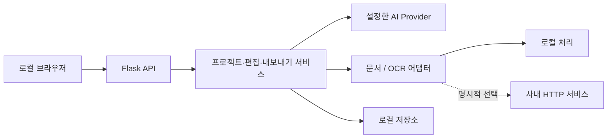

# 외부 연동 계약

현재 서비스 계층은 Flask 웹에서 사용합니다. FastMCP 전송 계층과 원격 파일 저장소는 후속 작업입니다.

| 기능 | 인터페이스 / 구현 | 선택 방법 |
|---|---|---|
| 텍스트·비전 | `ai_providers/text/base.py`, OpenAI/Gemini/Anthropic/Azure | 역할별 `*_MODEL_SOURCE`, `*_MODEL` |
| 이미지 생성·영역 수정 | `ai_providers/image/base.py`, OpenAI/Gemini/Azure | `IMAGE_MODEL_SOURCE`, 별도 Azure 이미지 배포 |
| 문서 → Markdown | `document_providers.DocumentProvider` | `DOCUMENT_PARSER=local/http/mineru` |
| OCR → 요소 목록 | `document_providers.OCRProvider` | `OCR_PROVIDER=local/http` |
| 배경 복원 | `image_editability.InpaintProvider` | `INPAINTING_PROVIDER=local/generative`, 프로젝트별 선택 |
| 글자 스타일 | `TextAttributeExtractor` | `TEXT_STYLE_PROVIDER=local/caption` |
| 파일 저장 | `storage.FileStorage`, `LocalFileStorage`, `FileService(storage=...)` | 기본 로컬, 주입 시 교체 |
| 자격 증명 | `runtime_config.secret` | 환경변수 또는 `NAME_FILE` |
| HTTPS | `http_transport` | 표준 프록시, `CORPORATE_CA_FILE` 추가 CA |

파일 저장소 계약은 렌더링 라이브러리가 요구하는 **로컬 staging 경로**를 제공합니다. 원격 object storage 업로드/다운로드 어댑터는 구현하지 않았습니다. 현재 파일 업로드·렌더링은 로컬 디스크를 사용하며 경로를 환경변수로 변경할 수 있습니다. 다중 사용자 격리와 인증은 이번 범위에 포함하지 않습니다.

## 사내 문서 파서

```dotenv
DOCUMENT_PARSER=http
DOCUMENT_PARSER_URL=https://parser.internal/parse
DOCUMENT_PARSER_TOKEN_FILE=C:/secrets/parser-token
```

요청은 `POST multipart/form-data`, 필드는 `file`, 인증은 선택적 `Authorization: Bearer ...`입니다. 응답은 `{"markdown":"내용"}`입니다. JSON 내 문자열을 반환해야 하며, 오류 상태는 서비스 실패로 처리합니다. 타임아웃은 300초입니다.

`DOCUMENT_PARSER=mineru`는 기존 MinerU v4 호환 경로를 명시적으로 사용하는 경우에만 선택합니다. `MINERU_API_BASE`와 `MINERU_TOKEN`이 모두 필요하고 기본 외부 주소는 없습니다. `local`은 파일을 파서 외부 서비스로 전송하지 않습니다.

## 사내 OCR

```dotenv
OCR_PROVIDER=http
OCR_API_URL=https://ocr.internal/recognize
OCR_API_KEY_FILE=C:/secrets/ocr-token
```

동일한 multipart `file` 요청으로 PNG 이미지를 전달합니다. 응답 예:

```json
{"elements":[{"type":"text","bbox":[80,120,620,170],"content":"분기 실적","metadata":{}}]}
```

좌표는 **입력 이미지의 실제 픽셀**, 순서는 `[x0,y0,x1,y1]`입니다. 0~1000 정규화 좌표가 아닙니다. `text`, `title`, `image`, `figure`, `table`, `equation`을 지원하며, 좌표 범위·내용 형식을 검증합니다. 원격 서비스가 반환한 `image_path`는 사용하지 않습니다.

## 기본 데이터 흐름



기존 JSON/Markdown 파싱용 내부 표식은 호환성을 위해 유지합니다. 사용자 화면은 한국어 사전을 사용하고 기본 생성 언어는 `ko`입니다. 운영 오류는 한국어로 정리하며, 제공자의 원본 오류 본문은 클라이언트에 그대로 반환하지 않습니다.
