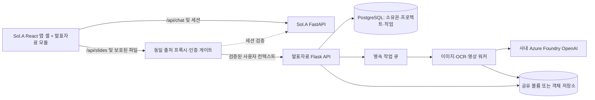

# GitHub Copilot 구현 프롬프트: Sol.A 발표자료 모듈 통합

다음 내용을 Sol.A 저장소의 GitHub Copilot Agent에 작업 지시로 사용한다. 이 문서는 **후속 통합 구현 명세**이며 아래 인증·큐·DB·멀티 사용자 기능이 현재 포크에 구현되었다는 뜻은 아니다.

## 목표와 현재 조건

Sol.A는 React/TSX 프론트엔드, FastAPI 백엔드, Outline OAuth 로그인, 세션 ID 기반 사용량 집계, master LLM과 외부 MCP 연결을 사용한다. 기존 Sol.A 백엔드에서 발표자료 생성 시 약 4명 동시 사용으로 CPU/메모리 피크와 컨테이너 재시작이 발생했다. Banana Slides에서 같은 문제가 재현되었다고 가정하지 않는다.

이 저장소의 발표자료 UI를 Sol.A의 사이드바 `발표자료` 탭과 앱 셸 안으로 이식한다. 발표자료 백엔드는 기존 Flask 코드를 유지한 별도 컨테이너로 분리한다. 1:N은 **하나의 프론트엔드가 Sol.A FastAPI와 발표자료 서비스 등 여러 백엔드를 사용하는 구조**다. 처음부터 여러 Banana API 복제본을 띄우라는 뜻이 아니다.

추가로 사용할 수 있는 리소스는 발표자료 프론트/백엔드 각 1 vCPU·2GB이다. UI를 Sol.A 프론트에 합칠 경우 남는 프론트 할당량을 영상·이미지 워커에 재배정할 수 있는지 배포 정책을 먼저 확인한다. 재배정이 불가능하면 한 발표자료 컨테이너 안에서 API/작업 프로세스의 합계 메모리를 제한하고 낮은 동시성으로 운영한다. 별도 워커에 무제한 리소스가 있다고 가정하지 않는다.

## 먼저 조사할 코드

Sol.A 저장소의 AGENTS.md, 프론트 라우터·레이아웃·인증 상태·API 클라이언트, FastAPI의 OAuth 콜백·세션 검증·사용량 집계·DB 모델·기존 발표자료 코드를 읽는다. 확인되지 않은 파일명, 인증 토큰 형식, 세션 테이블 또는 DB 접근 방식을 만들어 내지 않는다. 확인 결과와 실제 파일 경로를 작업 계획에 기록하고 기존 계약을 재사용한다.

발표자료 소스에서는 `frontend/src/App.tsx`, `api/client.ts`, `api/endpoints.ts`, `store/useProjectStore.ts`, `store/useExportTasksStore.ts`, `pages/`, `backend/controllers/`, `services/task_manager.py`, `services/ai_providers/`, `services/tts_video_service.py`, `services/storage.py`, `models/`를 확인한다.

## 구현할 변경

### 1. UI 이식과 경로

- 발표자료 기능을 `features/slides` 같은 독립 모듈로 옮긴다. 앱 셸·사이드바·로그아웃은 Sol.A에서 제공한다. 중첩 BrowserRouter, 중복 React/i18next 인스턴스, 전역 CSS와 Tailwind 토큰 충돌을 방지한다.
- `/slides`, `/slides/history`, `/slides/project/:id/outline`, `/detail`, `/template-setup`, `/preview`를 Sol.A 라우터에 등록한다. 기존 화면의 홈·설정·이력 링크와 이동 경로도 수정한다. iframe과 별도 페이지 리다이렉션을 기본 구현으로 사용하지 않는다.
- REST뿐 아니라 fetch POST 방식 SSE, 이미지 URL, 템플릿 URL, multipart 업로드, 영상/PPTX 다운로드까지 하나의 설정 가능한 URL 빌더를 사용한다. `/api`·`/files` 하드코딩과 `window.location.origin` 가정을 전수 점검한다. 기본값은 `/api/slides`, 파일은 `/api/slides/files`처럼 같은 출처에 둔다.
- 자동 저장 완료를 기다린 뒤 생성/내보내기를 시작한다. 사용자 수정 대본이 서버 저장 전에 영상 작업에 사용되는 경쟁 조건을 막는다.
- localStorage의 현재 프로젝트와 내보내기 이력을 안정적인 사용자 ID별로 분리한다. 로그아웃·사용자 전환 시 Zustand 상태, 폴링, SSE와 이전 사용자의 캐시를 해제한다.
- Sol.A 이름과 태양 로고를 사용하되 upstream AGPL 고지 및 수정 소스 링크는 보존한다.

### 2. 인증과 리소스 소유권

- Outline OAuth 로그인은 Sol.A에서 한 번만 처리한다. Banana에 OAuth 로그인·세션 DB 접근을 복제하지 않는다.
- 권장: 게이트에서 Sol.A 세션을 검증하고 짧은 만료시간·audience가 있는 내부 서명 컨텍스트를 발표자료 API로 전달한다. 사용자 ID, tenant ID(존재 시), 사용량 집계용 session ID, request ID를 포함한다. 외부에서 들어온 동일 헤더는 프록시가 제거한다.
- 브라우저가 임의로 보낸 `X-User-ID`를 신뢰하지 않는다. 발표자료 API 직접 접근도 우회 인증이 되지 않도록 제한한다. 쿠키 기반 변경 요청에는 기존 Sol.A CSRF 정책을 적용한다.
- Project, Task, Material, ReferenceFile, UserTemplate, UserStyleTemplate와 생성·내보내기 파일 모두 소유권을 검사한다. 공유가 필요하면 명시적 공유 모델을 만든다. UUID가 복잡하다는 이유로 접근 제어를 생략하지 않는다.
- 안정적인 사용자 ID는 소유권, 세션 ID는 요청·사용량 추적에 사용한다. 만료된 세션 때문에 기존 프로젝트의 소유권이 사라지지 않아야 한다.
- 현재 단일 전역 Settings의 모델·동시성·회사 디자인 정책 수정은 관리자 권한으로 보호한다. 개인 선호는 별도 사용자 설정에 둔다.

### 3. API·작업·리소스 격리

- Sol.A의 채팅 요청 프로세스에서는 이미지 디코딩, PDF 렌더링, OCR, PPTX 변환, FFmpeg 실행을 하지 않는다. 이미지/영상 응답 전체를 메모리에 적재하는 프록시도 금지한다. 인증 뒤 스트리밍하거나 짧은 만료의 파일 접근 권한을 발급한다.
- 기존 Flask REST 계약과 UI를 최대한 유지한다. 생성 요청은 `202 + task_id`, 이미지/영상 작업 상태는 폴링, 개요·설명 텍스트는 기존 SSE를 유지한다. WebSocket 추가는 필수 요구사항이 아니다.
- 현재 인프로세스 ThreadPoolExecutor는 영속 큐가 아니다. PostgreSQL 작업 테이블과 lease/heartbeat 또는 조직에서 지원하는 Redis 큐를 사용해 API와 워커를 분리한다. 작업 claim, 재시도, 타임아웃, 재시작 후 복구, 취소와 실패 결과를 설계한다.
- 시작값: 이미지 처리 1개, 영상 인코딩 1개, FFmpeg threads=1. 같은 2GB 예산을 공유한다면 이미지와 영상을 동시에 무제한 실행하지 않는다. 요청별 ThreadPoolExecutor 수를 늘려 전역 제한을 우회하지 않도록 한다.
- 실행 슬롯과 대기 큐 길이를 모두 제한한다. 포화 시 명시적인 `429/503 + Retry-After` 또는 대기 상태를 반환한다. 페이지 수·업로드 크기·PDF 해상도·이미지 픽셀 수·대본 길이·작업 기한을 서버에서 검증한다.
- 현재 영상 슬롯은 프로세스 내부 세마포어다. 여러 API/워커에 그대로 복제하면 제한이 배수로 늘어난다. 큐 또는 DB 기반 전역 실행 제한으로 교체한다.
- 페이지별로 저장하고 대형 이미지와 음성을 즉시 해제한다. 임시 파일 정리와 실패 시 부분 산출물 정책을 구현한다. 멀티프로세스에서 API 시작마다 모든 실행 작업을 실패로 표시하는 기존 startup reconciliation은 lease 기반으로 교체한다.

### 4. DB와 파일 저장소

- 조직의 PostgreSQL 연결 정책을 따른다. Sol.A와 같은 DB 인스턴스를 쓰더라도 별도 스키마/마이그레이션 소유권을 권장한다. Sol.A 인증 테이블을 발표자료 ORM에서 직접 수정하지 않는다.
- SQLite 전용 `connect_args`를 DB 종류별로 분리하고 실제 PostgreSQL에서 migration upgrade 및 기존 데이터 이전을 검증한다. 여러 API 복제본이 시작할 때 동시에 migration을 실행하지 않는다.
- `settings-test`라는 가짜 project_id로 Task를 만드는 현재 서비스 테스트 경로는 실제 FK 제약에 맞게 별도 시스템 작업 모델 또는 nullable 관계로 수정한다.
- DB에 이미지·음성 base64를 넣지 않는다. 단일 인스턴스 파일럿은 영속 볼륨을 사용할 수 있다. 여러 워커는 공유 저장소 또는 객체 저장소를 사용한다. 현재 파일 서비스는 로컬 경로 기반이므로 S3 URL만 바꿔 끼워 동작한다고 가정하지 않는다.
- 업로드·다운로드·삭제·작업용 로컬 staging을 포함한 저장소 계약을 구현한다. 데이터 삭제 시 참조 중인 파일을 먼저 확인하고 임시 파일과 최종 파일의 수명주기를 분리한다.

### 5. 모델과 사용량

- 제공자는 사내 Azure Foundry OpenAI로 고정한다. 텍스트·이미지 인식 GPT-5.5, 이미지 GPT-image-2, TTS는 사내 음성 배포를 사용한다. 공개 OpenAI/Gemini/Anthropic/Edge TTS/ElevenLabs fallback을 추가하지 않는다.
- endpoint, API version, 배포 이름, 키는 환경변수 또는 Secret Manager에서 주입한다. 키는 브라우저·DB·로그로 보내지 않는다. 사내 CA와 프록시를 유지하고 TLS 검증을 끄지 않는다.
- job_id/user_id/session_id/request_id를 요청 접수 시 저장하고 모든 비동기 작업·재시도에 전파한다. 텍스트 토큰, 이미지 생성 수/품질/해상도, TTS 입력량/음성 길이, 공급자 request ID와 상태를 기록한다.
- 현재 텍스트 어댑터는 문자열만 반환하므로 usage를 버리지 않도록 결과 계약을 확장하거나 사용량 이벤트 훅을 추가한다. Azure가 반환하지 않는 usage는 추정치로 명확히 구분한다.
- 요청 idempotency와 과금 이벤트 deduplication을 별도로 처리한다. 외부 모델 호출 결과가 불명확한 타임아웃은 무작정 재호출하지 않는다. UI 재접속으로 같은 유료 작업이 중복 생성되지 않도록 한다.
- 생성된 TTS 스크립트는 슬라이드 텍스트와 분리한다. 사용자 수정 스크립트는 내보내기 때 그대로 사용하고 비어 있는 페이지만 생성한다. 회사 디자인 프롬프트는 새 프로젝트에 스냅샷으로 적용하고 기존 프로젝트를 묵시적으로 바꾸지 않는다.

### 6. 운영과 검증

- 컨테이너용 WSGI 엔트리포인트는 `0.0.0.0` 바인딩과 graceful shutdown을 지원한다. 로컬 start.bat의 단일 PC 실행 잠금·브라우저 열기 동작을 컨테이너 진입점에 그대로 사용하지 않는다.
- liveness와 DB/큐/저장소 readiness를 구분한다. 실제 Azure 유료 호출을 health probe에 넣지 않는다. request/job ID를 로그와 메트릭에 연결하되 대본·키를 기록하지 않는다.
- Node 보안 기준은 `.nvmrc`와 package engines, 실행 전 검사에서 유지한다. 현재 웹 기준은 22.23.4이며 CVE-2026-111497 패치 이전 버전을 금지한다. 컨테이너는 태그 수정만으로 완료되지 않으므로 재빌드 후 실행 중 버전을 검증한다.
- 두 사용자 A/B로 프로젝트·작업·템플릿·소재·파일 접근을 검증한다. B가 A의 ID를 알고 있어도 조회·변경·삭제·다운로드할 수 없어야 한다.
- 실제 1 vCPU·2GB 제한에서 4명의 동시 요청을 재현한다. API 응답성, 큐 길이, RSS, CPU throttling, OOMKilled/exit code, 작업 실패·회복을 측정한다. 한 번 성공했다는 이유로 용량 보장을 선언하지 않는다.
- 작업 도중 워커 강제 종료, API 재시작, 모델 429/timeout, 저장소 장애, 사용자 로그아웃·재로그인과 브라우저 새로고침을 검증한다.
- 최종 산출물은 실제 PPTX를 열고 MP4의 영상·오디오 스트림, 재생 시간, 페이지 순서를 확인한다. 저장 직후 내보내기를 눌러도 마지막 수정 스크립트가 반영되어야 한다.

## 완료 결과

수정 코드·DB migration·환경변수 예시·라우팅 및 인증 계약·부하/회복 테스트 결과를 제출한다. 구현되지 않은 후속 작업은 명확히 구분한다. FastMCP는 다음 단계로 남기되 추후 MCP가 REST와 같은 인증·작업 서비스 계층을 호출할 수 있도록 비즈니스 로직을 HTTP 컨트롤러에서 분리한다. 검증이 끝나기 전 배포 완료 또는 동시 사용 안정성을 주장하지 않는다.
